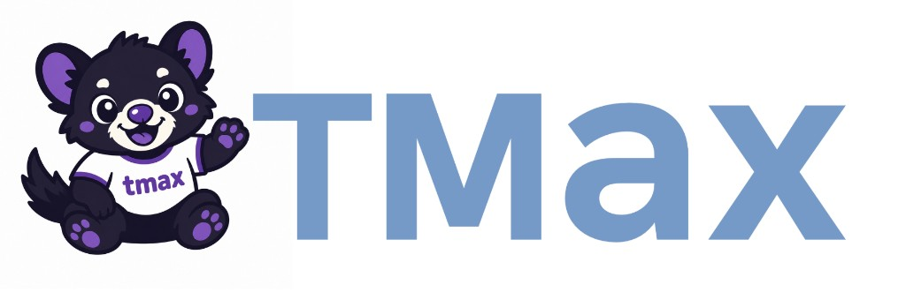
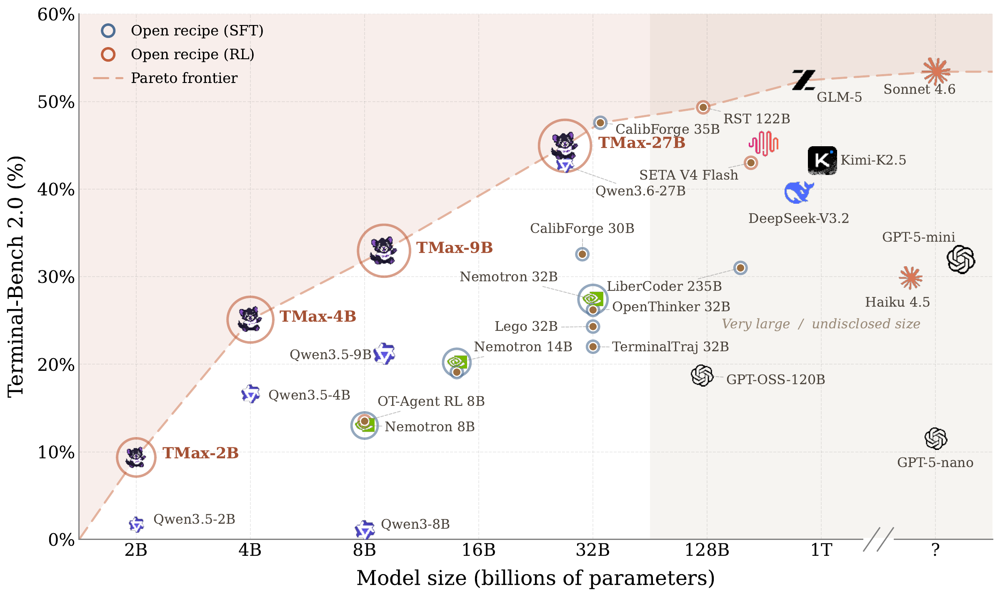

<p align="center">
  
</p>

<p align="center">
  <em>Simple terminal-using agents.</em>
</p>

<p align="center">
  💻 <a href="https://github.com/hamishivi/tmax">Code</a> ·
  🤗 <a href="https://huggingface.co/collections/TMaxxx/tmax-v11">Models &amp; Data</a> ·
  📜 <a href="https://arxiv.org/abs/2606.23321">Paper</a> ·
  📓 <a href="https://wai-org.com/blog/tmax/">Blog</a>
</p>

---

Tmax is our project around training simple, powerful terminal using agents. This codebase covers data generation, training, and evaluation.
We use this to train our 'tmax' series of models, with strong performance as shown below! Please refer to our [paper](https://arxiv.org/abs/2606.23321) for more details.


<p align="center">
  
</p>


Below, we give a quick overview of the codebase and how to use it.

### News

- [3/11/26] **TMax v1.1 released!** We have updated the codebase to improve stability and our overall recipe. Please consult [PR #11](https://github.com/hamishivi/tmax/pull/11) for the full set of changes. To reproduce TMax v1.0 training, please use commit [`6d3d606`](https://github.com/hamishivi/tmax/tree/6d3d606c0f9de6ceec9481f9ccc793936818fef0).
- Initial release of the codebase and models! Please read [our paper](https://arxiv.org/abs/2606.23321) for more details.


## What's here

The repo is organised around four stages of building a terminal agent:

| Stage | Where | What it does |
|-------|-------|--------------|
| **Data generation** | `rl_data/` | A simple, scalable, diverse, difficulty-aware pipeline for synthesising terminal-agent tasks, solving them at pass@k, analysing the corpus, and publishing it to the Hugging Face Hub. Tasks are sampled as an *independent product of structured axes* and packaged as self-contained Apptainer/Docker environments with programmatic verifiers. |
| **Agent** | `Vanillux2Agent/` | The Harbor agent used for solving and evaluation: a direct LiteLLM agent built on the vanillux prompt harness (mini-SWE-agent-derived prompts, bash tool schema, submit marker, format-error recovery, and output truncation), executing commands through Harbor's active environment. |
| **Training** | `training/open-instruct/` | A fork of [open-instruct](https://github.com/allenai/open-instruct) with fixes for Qwen 3.5 and terminal-agent training. SFT and DPPO RL launch scripts for the tmax models live under `training/open-instruct/scripts/tmax/`. |
| **Evaluation** | `scripts/` + `beaker_configs/` | Shell/Slurm launchers and a Beaker pipeline that serves a model with vLLM and runs Harbor datasets (Terminal-Bench, TB-Lite, SWE-bench) against it. |

## Quickstart

Python is run via [`uv`](https://github.com/astral-sh/uv); all commands run from
the repo root.

```bash
# Install dependencies
uv sync
```

### Generate task data

```bash
# 1. generate a small task corpus
NUM_TASKS=10 OUT_DIR=rl_data/output/tasks_smoke \
    bash rl_data/scripts/generate_tasks/run_generate_tasks.sh

# 2. solve the tasks with an LLM agent at pass@k
TASKS_DIR=rl_data/output/tasks_smoke \
    bash rl_data/scripts/generate_solutions/run_generate_solutions.sh

# 3. analyse pass@k + composition/balance stats
TASKS_DIR=rl_data/output/tasks_smoke \
    bash rl_data/scripts/analyze/run_analyze.sh
```

[`rl_data/README.md`](rl_data/README.md) is the entry point for the data side
of the project: it walks through the compositional sampler (the orthogonal
axes that define a task), the four-stage pipeline
(`generate_tasks → generate_solutions → analyze → upload_to_hf`), the corpus
kinds (`legacy` / `sft_v2` / `rl_v2`), the SFT warm-start set, and how to
evaluate on our published Harbor dataset. Start there for anything data-related.

### Train a model

SFT and DPPO RL are run via the open-instruct fork in `training/open-instruct/`.
Launch scripts for the tmax models live under `training/open-instruct/scripts/tmax/`
(`SFT/` and `RL/`):

```bash
# from training/open-instruct/, with BEAKER_CLUSTER configured, e.g. Qwen3.5-4B
bash scripts/tmax/RL/qwen35_4b.sh <beaker-image>
```

See [`training/open-instruct/scripts/tmax/README.md`](training/open-instruct/scripts/tmax/README.md)
for runtime configuration, Sandfleet execution, dataset overrides, and pretokenized SFT input.

### Evaluate a model

Run a Harbor dataset against a locally served model on Beaker, with
`BEAKER_CLUSTER` configured for your environment:

```bash
./beaker_configs/launch_eval.sh TMaxxx/tmax-9b-v1.1 \
    --revision main \
    --name tmax-v1.1-9b \
    --tool-call-parser qwen3_xml \
    --cluster "$BEAKER_CLUSTER" \
    --dataset terminal-bench@2.0
```

See [`scripts/beaker/README.md`](scripts/beaker/README.md) for the full eval
pipeline, flags, and troubleshooting.

#### Evaluate manually

To run an eval yourself on a node with GPUs (no Beaker), serve the model with
vLLM and point Harbor at it:

```bash
# 1. serve the model on localhost:8008 (a separate shell/process)
uvx vllm==0.19.1 serve TMaxxx/tmax-9b-v1.1 \
    --served-model-name tmax-v1.1-9b \
    --enable-auto-tool-choice --tool-call-parser qwen3_xml \
    --tensor-parallel-size 8 --port 8008

# 2. set the Daytona API key
export DAYTONA_API_KEY='xxx'

# 3. run a Harbor dataset against the local vLLM endpoint
uv run harbor run \
  --dataset terminal-bench@2.0 \
  --env daytona \
  --agent-import-path Vanillux2Agent:Vanillux2Agent \
  --model openai/tmax-v1.1-9b \
  --agent-kwarg api_base=http://localhost:8008/v1 \
  --n-concurrent 16 \
  -k 5 \
  --job-name tmax-v1.1-9b-terminal-bench-2.0
```

Feel free to swap out daytona for your sandboxing backend of choice.

## Task data on Harbor

The **13,565 hardened tasks used by TMax v1.1** are public on Harbor Hub as
**[`tmax/tmax-13k-v1.1`](https://hub.harborframework.com/datasets/tmax/tmax-13k-v1.1)**.
The `v1.1` and `latest` tags resolve to the same complete release. Its pinned
task references preserve the instructions, verifiers, supporting test assets,
and Docker wrappers from the
[Hugging Face Harbor export](https://huggingface.co/datasets/TMaxxx/tmax-13k-v1.1-harbor).
The [training data](https://huggingface.co/datasets/TMaxxx/tmax-13k-v1.1) and
[metadata companion](https://huggingface.co/datasets/TMaxxx/tmax-13k-v1.1-metadata)
cover the same task IDs.

```bash
# Evaluate an agent on a 10-task subset using Docker.
# Set MODEL to your provider/model and configure its API credentials.
uvx --from harbor==0.25.0 harbor run -d "tmax/tmax-13k-v1.1@v1.1" \
    --agent terminus-2 --model "$MODEL" --env docker -l 10
```

This command uses Harbor 0.25.0, the version verified with the Hub release.
Drop `-l` to run the full set, or use `-i`/`-x` to include/exclude tasks by name.
Per-task rewards and agent/verifier logs land under `jobs/<job-name>/`. See
[`rl_data/README.md`](rl_data/README.md#evaluating-on-the-published-harbor-dataset)
for the full set of run options.

The earlier 14,601-task release remains available as
[`tmax/TMax-15K-Harbor`](https://hub.harborframework.com/datasets/tmax/TMax-15K-Harbor).
It contains the original tasks before the v1.1 audit, repairs, and exclusions.

## Requirements

- **[`uv`](https://github.com/astral-sh/uv)** for dependency management (deps pinned in `pyproject.toml` / `uv.lock`).
- An **LLM API key** for the configured model (e.g. `GEMINI_API_KEY`); local
  vLLM / Ollama / OpenAI-compatible endpoints are also supported via env vars.
- (for data generation) **`apptainer`** on PATH for building and running task containers.
- (for training) A configured **Docker/Podman**, **Apptainer**, or **Sandfleet** backend. Docker Hub credentials may be needed for authenticated or high-volume image pulls; Apptainer and Sandfleet can use prepared SIF images. See the [training recipes](training/open-instruct/scripts/tmax/README.md) for setup.
- **`HF_TOKEN`** for the Hugging Face upload stage and for pulling gated models.
- (to evaluate on the published Harbor datasets) a model API key
  for your chosen agent plus a container runtime — Docker locally, or
  `DAYTONA_API_KEY` for the Daytona sandbox on Docker-less hosts.

## TMax Releases

- **V1.1:**
  - Models and data: [TMax v1.1 collection](https://huggingface.co/collections/TMaxxx/tmax-v11).
  - Harbor dataset: [`tmax/tmax-13k-v1.1@v1.1`](https://hub.harborframework.com/datasets/tmax/tmax-13k-v1.1) (13,565 tasks).
  - Evaluation rollouts: [`evaluation_assets/v1.1/`](evaluation_assets/v1.1/) (2B, 4B, 8B, 9B, and 27B on Terminal-Bench 2.0 using Daytona).
- **V1.0:**
  - Models and data: [Ai2 TMax collection](https://huggingface.co/collections/allenai/tmax).
  - Evaluation rollouts: [`evaluation_assets/v1.0/`](evaluation_assets/v1.0/).
  - Training code: [`6d3d606`](https://github.com/hamishivi/tmax/tree/6d3d606c0f9de6ceec9481f9ccc793936818fef0).

## Licensing

This codebase is licensed under Apache 2.0 as given in [LICENSE](LICENSE).

The TMax v1.1 training data, metadata, and Harbor export use
[ODC-BY](https://opendatacommons.org/licenses/by/1-0/), following the
[original TMax dataset](https://huggingface.co/datasets/allenai/TMax-15K).
Research and educational use should follow
[Ai2's Responsible Use Guidelines](https://allenai.org/responsible-use).
Gemini 3.1 Pro outputs included in the data remain subject to
[Google's Terms of Service](https://policies.google.com/terms).

# Citation

If you use this codebase or models in your research, please cite our paper:

```bibtex
@misc{ivison2026tmaxsimplerecipeterminal,
      title={Tmax: A simple recipe for terminal agents}, 
      author={Hamish Ivison and Junjie Oscar Yin and Rulin Shao and Teng Xiao and Nathan Lambert and Hannaneh Hajishirzi},
      year={2026},
      eprint={2606.23321},
      archivePrefix={arXiv},
      primaryClass={cs.CL},
      url={https://arxiv.org/abs/2606.23321}, 
}
```
